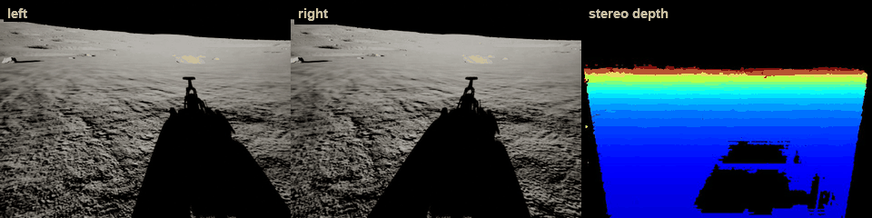
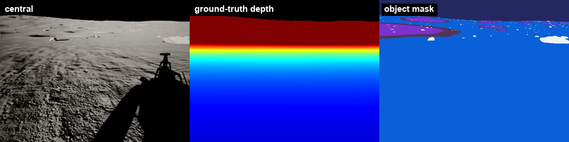

# UnrealStereoCam

Streams Unreal camera images (stereo navcams, object mask, ground-truth depth,
extra cameras) to ROS over TCP, without stalling the game thread.

*The rover driving on the Moon in GNC Moon Simulator. Top: the left and right
navcams and the depth GNC computes from them. Bottom: the central camera, the
ground-truth depth and the object mask.*

Part of [GNC Moon Simulator](https://github.com/raulcastar/GNC-Moon-Simulator):
its `component_stereo_depth` node receives the frames on port 3004.

## Requirements

Unreal Engine 5.7 on Windows (the version it is developed and tested with).
Building from source also needs Visual Studio 2022 with the *Game development
with C++* workload.

## Install

- **Prebuilt (UE 5.7, Win64):** download `UnrealStereoCam-<version>-UE5.7-Win64.zip`
  from [Releases](https://github.com/raulcastar/UnrealStereoCam/releases) and extract it
  into `<YourProject>/Plugins/`.
- **From source:** clone this repository into `<YourProject>/Plugins/UnrealStereoCam`,
  open the project and answer **Yes** to rebuild the module.

Then check it is enabled under *Edit → Plugins → Project → Other*.

## Use

1. Add three **SceneCaptureComponent2D** named `NavcamLeft`, `NavcamRight` and
   `NavcamCenter` to the rover, each with a 640×480 render target.
2. Add the **UnrealStereoCam** component to the same actor.
3. Press Play: frames go to `127.0.0.1:3004`.

## Dependencies

None to build or run: only engine modules. It stamps its data with the shared
simulation time (its own copy of `GncSimTime.h`); add
[UnrealSimClock](https://github.com/raulcastar/UnrealSimClock) so ROS gets `/clock` on the same time base.

The optional [object mask](docs/object-mask.md) needs the `PPM_GroundTruthMask`
material, which [Terrain Studio](https://github.com/raulcastar/Unreal-Moon-Terrain-Generation)
creates.

## Docs

| | |
|---|---|
| [Setup in detail](docs/setup.md) | Cameras, component settings, the ROS side |
| [Object mask](docs/object-mask.md) | Per-object segmentation with Custom Depth-Stencil |
| [Options](docs/options.md) | Ground-truth depth, extra cameras, exposure |
| [How it works](docs/how-it-works.md) | Render on demand, asynchronous readback |
| [Wire format](docs/wire-format.md) | The TCP packet layout |
| [Making a release](docs/release.md) | Building the prebuilt zip for GitHub releases |

## License

[MIT](LICENSE), © 2026 Raul Castilla Arquillo.
